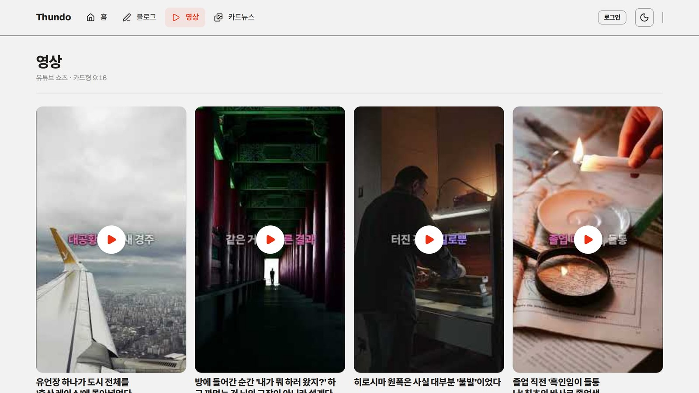

<!-- 이 README 상단·하단 배너는 capsule-render, 타이핑 문구는 readme-typing-svg 로 그립니다. -->
<!-- 뱀 애니메이션은 .github/workflows/snake.yml 이 매일 output 브랜치에 새로 그려 넣습니다. -->

<div align="center">


<a href="https://github.com/yoonsundo"></a>

<p>
  <a href="https://www.thundo.kr"></a>
  <a href="https://punchgrow.thundo.kr"></a>
  
</p>

</div>

## 👋 반가워요

아이디어를 **끝까지 굴러가는 제품**으로 만드는 개발자입니다.<br />
기획 · 디자인 · 개발 · 배포 · 운영까지, 혼자서도 한 바퀴를 끝까지 돌리는 걸 좋아합니다.<br />
요즘은 **AI 에이전트를 팀원처럼 부리는 법**과 **생산성 도구를 게임처럼 만드는 법**에 빠져 있어요.

```ts
const thundo = {
  mission:   "쓸모 있고, 재미있는 소프트웨어",
  building:  ["PunchGrow 🐣", "Thundo 🤖"],
  stack: {
    apple:   ["Swift", "macOS", "Homebrew"],
    web:     ["TypeScript", "Next.js", "React"],
    mobile:  ["React Native", "Expo"],
    backend: ["Node.js", "Python", "Supabase", "PostgreSQL"],
  },
  teammates: ["Claude Code", "Codex"],          // 매일 같이 일하는 페어 프로그래머
  rules:     ["local-first", "gate-first", "no-slop"],
  fuel:      "☕ × ∞",
} as const satisfies Developer;
```

## 🚀 지금 만들고 있는 것

<table>
  <tr>
    <td width="50%" valign="top">
      <a href="https://github.com/yoonsundo/punchgrow">
        
      </a>
      <h3>🐣 <a href="https://github.com/yoonsundo/punchgrow">PunchGrow</a></h3>
      <p><b>코딩할수록 크리처가 자라는 macOS 게임.</b><br />
      Claude Code · Codex 사용량이 먹이가 되는 로컬 우선 메뉴 막대 앱입니다. 데이터는 기기 밖으로 나가지 않아요.</p>
      <p>
        
        
        
        
      </p>
      <p><a href="https://punchgrow.thundo.kr">웹사이트</a> · <a href="https://punchgrow.thundo.kr/dex/">전체 도감</a> · <a href="https://github.com/yoonsundo/punchgrow#quick-start">설치하기</a></p>
    </td>
    <td width="50%" valign="top">
      <a href="https://github.com/yoonsundo/thundo-agent-public">
        
      </a>
      <h3>🤖 <a href="https://github.com/yoonsundo/thundo-agent-public">Thundo</a></h3>
      <p><b>AI 에이전트 45마리가 매일 콘텐츠를 만드는 시스템.</b><br />
      블로그 3편 · 유튜브 쇼츠 · 카드뉴스를 무인 발행하고, 결정론 게이트 16종과 검증자 5명이 못 만든 결과물을 막습니다.</p>
      <p>
        
        
        
        
      </p>
      <p><a href="https://www.thundo.kr">산출물 보기</a> · <a href="https://github.com/yoonsundo/thundo-agent-public">저장소</a></p>
    </td>
  </tr>
</table>

## 🧭 이렇게 일합니다

<table>
  <tr>
    <td width="50%"><b>🔒 로컬 우선</b><br /><sub>데이터는 사용자 기기에. 서버는 정말 필요할 때만 둡니다.</sub></td>
    <td width="50%"><b>🚦 게이트 우선</b><br /><sub>많이 만드는 것보다, 못 만든 걸 내보내지 않는 구조를 먼저 설계합니다.</sub></td>
  </tr>
  <tr>
    <td width="50%"><b>🤖 AI 네이티브</b><br /><sub>Claude Code · Codex는 데모가 아니라 매일 같이 일하는 팀원입니다.</sub></td>
    <td width="50%"><b>🎮 재미도 기능이다</b><br /><sub>생산성 도구도 게임처럼 즐거울 수 있다고 믿습니다.</sub></td>
  </tr>
</table>

## 🛠️ 기술 스택

<p align="center">
  
</p>
<p align="center">
  
  
  
  
</p>

## 🐍 잔디 먹는 뱀

<p align="center">
  <picture>
    <source media="(prefers-color-scheme: dark)" srcset="https://raw.githubusercontent.com/yoonsundo/yoonsundo/output/github-snake-dark.svg" />
    <source media="(prefers-color-scheme: light)" srcset="https://raw.githubusercontent.com/yoonsundo/yoonsundo/output/github-snake.svg" />
    
  </picture>
  <br />
  <sub>제 잔디를 먹고 자랍니다. 매일 새로 그려지니, 굶기지 않으려면 오늘도 커밋 🌱</sub>
</p>

<details>
<summary><b>🥚 수상한 알을 발견했습니다. 눌러서 부화시키기</b></summary>
<br />

```text
           ✦      ·      ✧
       ╭────────────╮
       │   ◕    ◕   │   < 삐약! 나는 커밋을 먹고 자라요
       │     ▿      │
       ╰──┬──────┬──╯
          ┘      └

╭─────────────── STATUS ───────────────
│ NAME     thundo
│ CLASS    1인 프로덕트 메이커
│ TITLE    「에이전트 45마리의 주인」
│ HP       ██████████  커피로 자동 회복
│ MP       ███████░░░  Claude 토큰 잔량
│ PASSIVE  잔디가 비어 있으면 잠이 안 옴
│ SKILLS   기획 · 디자인 · 개발 · 배포 · 운영
╰──────────────────────────────────────
```

이 친구를 진짜로 키워보고 싶다면 👉 **[PunchGrow 설치하기](https://github.com/yoonsundo/punchgrow#quick-start)**

</details>

<div align="center">

<sub>오늘도 잔디 심는 중 🌱 들러주셔서 고마워요!</sub>


</div>
