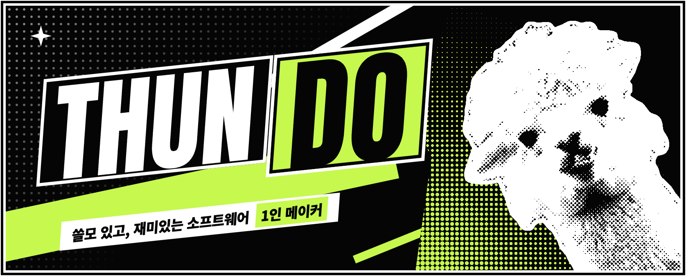
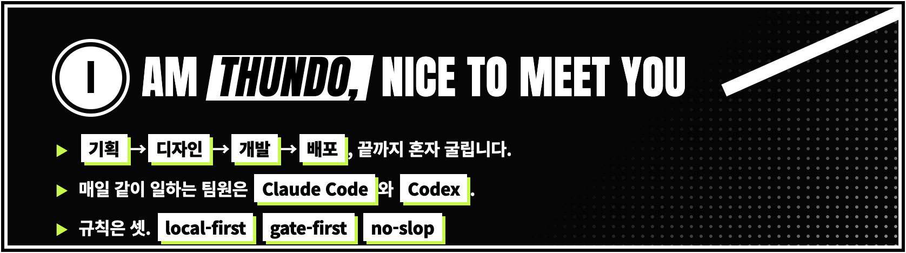
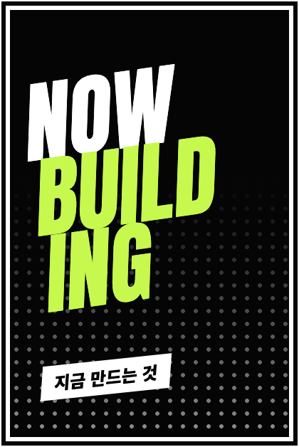
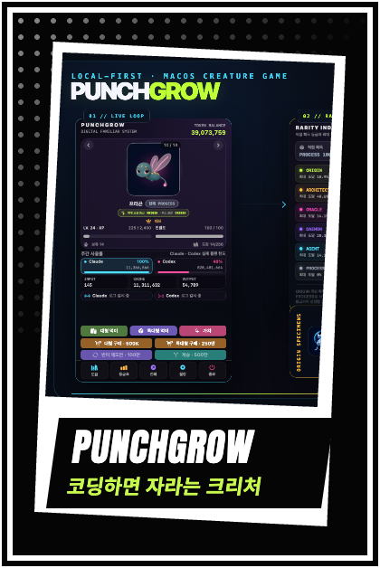
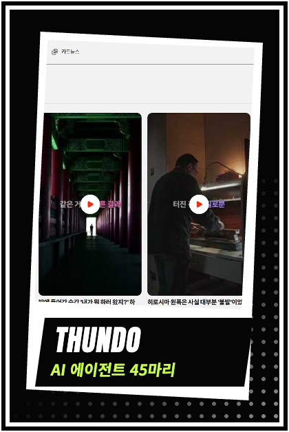
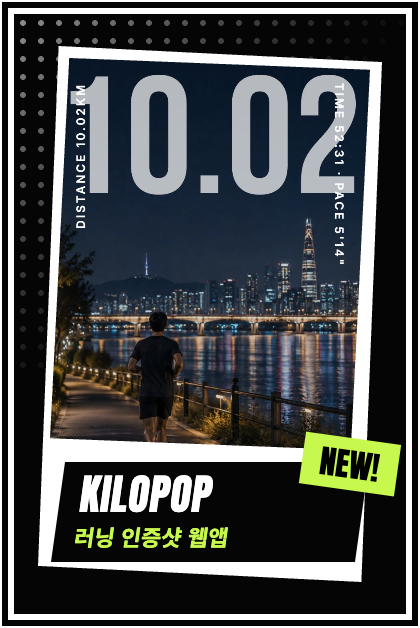
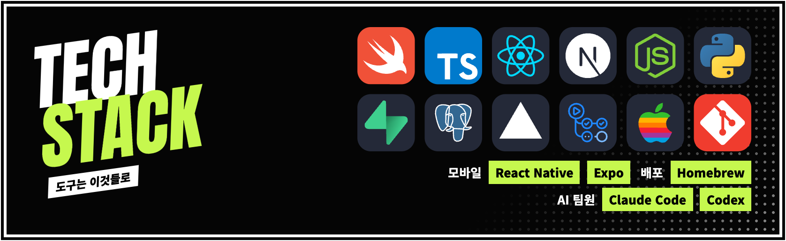
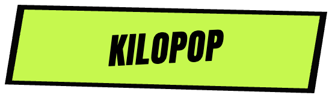
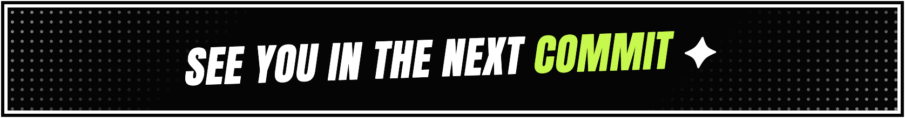

<!-- 패널 그림(assets/profile/*.png)은 만화 패널 콜라주 풍으로 HTML에 그린 뒤 2배 해상도로 캡처한 것입니다. -->
<!-- 뱀 애니메이션은 .github/workflows/snake.yml 이 매일 output 브랜치에 새로 그려 넣습니다. -->

<p align="center">
<a href="https://www.thundo.kr"></a><br />
<br />
<a href="https://github.com/yoonsundo/punchgrow"></a><a href="https://github.com/yoonsundo/thundo-agent-public"></a><a href="https://github.com/yoonsundo/kilopop-site"></a><br />
<br />
<a href="https://www.thundo.kr"></a><a href="https://punchgrow.thundo.kr"></a><a href="https://kilopop.thundo.kr"></a>
</p>

<p align="center">
  
</p>

<p align="center">
  <picture>
    <source media="(prefers-color-scheme: dark)" srcset="https://raw.githubusercontent.com/yoonsundo/yoonsundo/output/github-snake-dark.svg" />
    <source media="(prefers-color-scheme: light)" srcset="https://raw.githubusercontent.com/yoonsundo/yoonsundo/output/github-snake.svg" />
    
  </picture>
  <br />
  <sub>제 잔디를 먹고 자랍니다. 매일 새로 그려지니, 굶기지 않으려면 오늘도 커밋 🌱</sub>
</p>

<details>
<summary><b>🥚 수상한 알을 발견했습니다. 눌러서 부화시키기</b></summary>
<br />

```text
           ✦      ·      ✧
       ╭────────────╮
       │   ◕    ◕   │   < 삐약! 나는 커밋을 먹고 자라요
       │     ▿      │
       ╰──┬──────┬──╯
          ┘      └

╭─────────────── STATUS ───────────────
│ NAME     thundo
│ CLASS    1인 프로덕트 메이커
│ TITLE    「에이전트 45마리의 주인」
│ HP       ██████████  커피로 자동 회복
│ MP       ███████░░░  Claude 토큰 잔량
│ PASSIVE  잔디가 비어 있으면 잠이 안 옴
│ SKILLS   기획 · 디자인 · 개발 · 배포 · 운영
╰──────────────────────────────────────
```

이 친구를 진짜로 키워보고 싶다면 👉 **[PunchGrow 설치하기](https://github.com/yoonsundo/punchgrow#quick-start)**

</details>

<p align="center">
<br />

</p>
